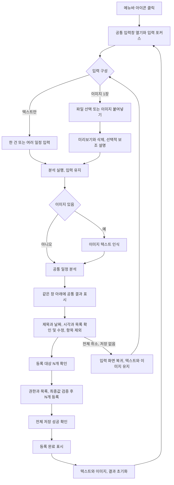

# MVP 사용자 흐름과 화면 상태 설계

- 작성일: 2026-10-27
- 문서 버전: 0.1
- 노션 개발 문서: [MVP 사용자 흐름과 화면 상태 설계](https://app.notion.com/p/406f8dfb2e3c810ea4bec6de2b0be38e)
- 상태: 개발 설계 초안. 기능 구현, 디자인 확정, 실기 검증 완료를 뜻하지 않음
- 대상: macOS 메뉴바 앱의 입력부터 Apple 미리 알림 등록까지
- 목적: 화면과 예외 상태를 먼저 정리해 후속 디자인 시스템, 컴포넌트, 기능 연결의 기준으로 사용

## 1. 기준과 읽는 방법

| 근거 | 적용 기준 |
| --- | --- |
| [1차 MVP 구현 기획안](https://app.notion.com/p/401f8dfb2e3c81dda2dff02234c3c309) | 2026-10-27 수정본을 우선함. 아래의 절 번호는 이 문서의 절을 가리킴 |
| [1차 기능명세서](https://app.notion.com/p/403f8dfb2e3c80a38bdfda146386eb60)와 [기능 DB](https://app.notion.com/p/ccdb6efc78e44fab8f2ad2a37e000a48) | 아래의 F01~F26은 DB의 01~26번 기능을 가리킴 |
| [추가 기능: 이미지 기반 일정 등록](https://app.notion.com/p/406f8dfb2e3c8113b90bd7724aeab3d6) | 이미지 1장, 보조 설명, OCR과 이미지 예외 상태의 보완 근거 |
| [macOS 개발 경계](../rules/macos-development.md) | 미검증 모델 출력, 날짜, 권한, 저장 시점, 비동기 수명 검토 기준 |

본문의 **확정**은 기획에서 합의된 제품 동작이다. **구현 제안**은 이를 안전하게 연결하기 위한 검토안이며, **결정 필요**는 아직 선택하지 않은 UX나 정책이다. 상태 ID는 문서 내 추적용 이름으로, 특정 Swift enum이나 아키텍처 구현을 강제하지 않는다.

현재 native 코드는 메뉴바 창과 텍스트 입력 중심의 초기 화면이다. 이 문서는 앞으로 구현할 흐름을 설명한다. 별도 웹 프로토타입의 화면은 제품 정책이나 native 구현 완료의 증거로 사용하지 않는다.

## 2. MVP 경계

**확정:** 하나의 입력창에서 텍스트만 입력하거나 이미지 1장을 첨부한다. 이미지만으로도 분석할 수 있고, 텍스트를 보조 설명으로 덧붙일 수 있다. 한 건과 여러 건 모두 같은 결과 확인 단계를 거친 뒤 Apple 미리 알림에 등록한다. [기획 2~5절, F01~F04, F10~F15, F22~F26]

개별 입력 폼, 입력 방식 선택 탭, 사전 날짜 선택, 음성 입력, 이미지 여러 장 분석, 카카오톡 직접 수집, 캘린더 이벤트 생성, 저장된 일정 조회와 수정 및 삭제는 이번 범위에서 제외한다. 결과 항목의 직접 수정은 유지한다. [기획 2~4절, F01, F11]

기존 기획은 Apple 시스템 모델로 등록 흐름을 우선 완성하는 것을 목표로 한다. 현재 [#15 기술 검증](../ai-workflow/tasks/15/spec.md) 구현은 Gemini API를 사용하며, 입력 텍스트와 Vision OCR 결과 및 보조 설명을 Google로 전송한다. 이미지 원본은 전송하지 않는다. 배포용 서버와 API 키 보호는 아직 구현하지 않았다. 이미지 인식은 Vision OCR 결과를 공통 분석으로 넘기는 **구현 제안**이며 모델이 이미지를 직접 해석한다고 가정하지 않는다. [기획 7~8절, F18, F24]

## 3. 정상 사용자 흐름

도식의 이미지 텍스트 인식 경로는 구현 제안이며, 실패와 권한 분기는 다음 상태 표에서 다룬다. 권한 요청과 목록 조회를 분석 전후 어느 시점에 노출할지는 미정이다. 목록 추천에는 실제로 조회한 기존 목록이 필요하고 저장 직전에는 다시 유효성을 확인한다. [기획 5, 7, 10절, F07~F08, F14, F17]

창은 등록 성공 후에도 유지된다. `N개 등록`은 저장 전 동작이며 `등록 완료`는 전체 성공을 확인한 뒤의 상태 문구다. 완료 문구의 표시 시간과 다음 입력 포커스 시점은 결정 필요다. [기획 4절, F15]

## 4. 화면 상태와 전이

아래 버튼 문구 중 기획에 명시된 것은 `N개 등록`, `등록 완료`, `목록 선택 필요`, `시간 추가` 또는 `시간 확인 필요`다. 나머지 오류 문구와 재시도 버튼의 이름 및 배치는 구현 제안이다. N은 이번에 제외하지 않은 등록 대상 항목 수이며, 성공한 저장 수와 혼동하지 않는다.

### 4.1 입력과 분석

| 상태 ID | 진입 조건 | 표시 요소 | 허용 행동과 버튼 상태 | 데이터 보존 | 다음 상태 | 구분과 근거 |
| --- | --- | --- | --- | --- | --- | --- |
| S01 기본 입력 | 메뉴바 창 최초 열기 또는 전체 성공 후 초기화 | 공통 입력 바, 첨부 버튼, 안내, 텍스트 포커스 | 텍스트 입력, 파일 선택, 이미지 붙여넣기. 텍스트와 이미지가 모두 없으면 분석 불가 | 작성 중 텍스트 유지 | S02, S03, S04, S05 | 확정: 기획 4절, F01~F03, F22 |
| S02 이미지 첨부 | 파일 선택 또는 붙여넣기로 이미지 1장 확보 | 입력 바 위 작은 미리보기와 삭제 버튼, 선택적 보조 설명 | 이미지 삭제, 설명 작성, 분석. 이미지 단독도 분석 가능 | 텍스트와 이미지 유지 | S01, S03, S04, S05 | 확정: 기획 4절, F22~F23. 두 번째 이미지와 형식 제한은 결정 필요 |
| S03 파일 선택 취소 | 파일 선택창에서 취소 | 선택창을 열기 전 화면 | 기존 입력을 계속 편집하거나 분석 | 기존 텍스트와 첨부를 변경하지 않음 | 직전 S01 또는 S02 | 구현 제안: F22의 파일 선택을 취소했을 때 데이터 손실 방지 |
| S04 입력 검증 안내 | 빈 입력으로 실행 요청 또는 처리할 수 없는 입력 확인 | 입력 근처의 원인 안내 | 입력 보완. 유효 입력이 없으면 분석과 등록 불가 | 기존 입력 유지 | S01, S02, S05 | 확정: F03은 텍스트 또는 이미지 필요. 오류 배치, 길이와 형식 기준은 결정 필요 |
| S05 분석 진행 | 유효 입력으로 분석 시작 | 진행 표시, 원래 텍스트와 미리보기 | 중복 분석과 등록 차단 제안. 진행 중 입력 편집 및 분석 취소 UX는 결정 필요 | 해당 요청의 텍스트와 이미지 유지 | S06~S09, S14, S16 | 확정: 기획 4절, F03. 중복 요청 제어는 구현 제안 |
| S06 이미지 인식 실패 | OCR 실패 또는 읽을 텍스트 확보 실패 | 인식 실패 안내를 일정 없음과 구분 | 이미지 교체, 텍스트 보완, 재분석. 등록 불가 | 텍스트와 이미지 보존 | S01, S02, S05 | 확정: 기획 5절, F26. 세부 재시도 UI는 결정 필요 |
| S07 일정 분석 실패 | 인식 또는 입력은 확보했으나 분석 완료 실패 | 분석 오류 안내를 OCR 실패와 구분 | 입력 보완, 재시도 제안. 유효 결과 없이 등록 불가 | 텍스트와 이미지 보존 제안 | S01, S02, S05 | 구현 제안 및 결정 필요: 기획 10절, F18 |
| S08 일정 없음 | 분석은 완료했으나 일정 후보가 없음 | 일정 없음 안내, 원래 입력 | 입력 및 이미지 변경, 재분석. 등록 불가 | 텍스트와 이미지 보존 | S01, S02, S05 | 확정: 기획 5절, F26. 문구와 빈 결과 판정 세부는 결정 필요 |
| S09 모델 사용 불가 | 선택한 모델의 가용 조건 미충족 | 분석 오류와 구분한 사용 불가 안내 | 입력 보존, 가용 상태 재확인 제안. 분석과 등록 불가. 개별 입력 폼으로 우회하지 않음 | 텍스트와 이미지 보존 제안 | 가용 회복 후 S05 | 구현 제안 및 결정 필요: 기획 7, 10절, F18. 현재 검증은 Gemini API 사용 |

### 4.2 권한과 기존 목록

권한과 목록 상태는 분석 및 편집 상태와 함께 존재할 수 있다. 아래 행을 이유로 새 화면이나 단계별 마법사를 반드시 추가하지 않는다.

| 상태 ID | 진입 조건 | 표시 요소 | 허용 행동과 버튼 상태 | 데이터 보존 | 다음 상태 | 구분과 근거 |
| --- | --- | --- | --- | --- | --- | --- |
| S10 권한 미결정 | 미리 알림 접근 권한이 아직 결정되지 않음 | 접근 목적과 시스템 권한 요청 안내 제안 | 사용자 권한 요청 흐름. 권한 확보 전 목록 조회와 저장 성공 처리 불가 | 입력과 확보한 결과 보존 제안 | S11, S12 또는 S14 | 구현 제안: F17. 요청 시점과 설명 문구는 결정 필요 |
| S11 권한 거부 또는 변경 | 요청 거부, 분석 후 접근 철회 등 | 현재 접근 불가 안내 | 권한 회복 방법 안내와 재확인 제안. 접근 회복 전 등록 불가 | 입력과 결과 보존 제안 | 회복 후 S12 또는 S14 | 구현 제안: F17. 설정 이동과 회복 후 재시도 UX는 결정 필요 |
| S12 목록 조회 진행 | 권한 확보 후 기존 목록 조회 또는 재조회 | 목록 준비 중 표시 제안 | 입력 및 결과 확인 가능. 추천 후보와 선택지는 조회 결과 확보 후 제공 | 입력과 결과 보존 | S13 또는 S14 | 확정: 기획 5절, F07. 비동기 진행 표시와 조작 범위는 구현 제안 |
| S13 목록 없음 또는 조회 실패 | 쓰기 가능한 기존 목록 없음, 또는 목록 조회 오류 | 목록 없음과 불러오기 실패를 다른 원인으로 안내 | 재조회, 해당 항목 제외, 전체 취소 제안. 유효 목록 없는 항목 저장 불가. 새 목록 자동 생성 안 함 | 입력과 결과 보존 제안 | S12, S14, S01 또는 S02 | 확정: F07, F14. 안내 및 복구 UI는 구현 제안 및 결정 필요 |

### 4.3 결과 확인과 저장

| 상태 ID | 진입 조건 | 표시 요소 | 허용 행동과 버튼 상태 | 데이터 보존 | 다음 상태 | 구분과 근거 |
| --- | --- | --- | --- | --- | --- | --- |
| S14 결과 확인 및 수정 | 한 건 이상의 분석 결과 확보 | 같은 창 아래 제목, 날짜, 시각, 추천 목록, 개수, 장소 및 부가 정보 | 항목 직접 수정, 제외, 전체 취소, 등록. 메모 편집 UI는 제안. 전부 제외하면 등록 비활성화 제안 | 원래 입력과 편집 중 임시 결과 유지 | S15~S18, 취소 시 S01 또는 S02 | 확정: 기획 4절, F10~F14, F25 |
| S15 목록 선택 필요 | 목록 추천 미선택, 잘못된 ID, 삭제 또는 쓰기 불가 목록 | 해당 항목의 목록 선택 필요, 기존 유효 후보 | 목록 재선택 또는 항목 제외. 미선택 항목을 기본 목록으로 바꿔 저장하지 않음. 전체 등록 보류와 해당 항목 안내는 구현 제안 | 입력과 수정 결과 유지 | S14, S12 | 확정: 기획 5절, F08, F11, F14. 일괄 버튼 동작의 구체 UX는 결정 필요 |
| S16 날짜 확인 필요 | 연도 충돌, 유효하지 않은 날짜, 해석 불명확 | 확인 필요 표시와 읽힌 월일 등 수정 근거 | 날짜 확인 및 수정, 제외. 유효하지 않은 연도 저장 금지. 확인 항목이 남았을 때 일괄 등록 보류 방식은 결정 필요 | 읽힌 원정보와 입력, 다른 편집 결과 유지 | S14 | 확정: 기획 5~6절, F05, F10~F11. 검증 UI는 결정 필요 |
| S17 시간 확인 또는 추가 | 정확하지 않은 시간 표현, 종료 시각만 존재 등 | 시간 추가 또는 시간 확인 필요, 원표현과 종료 정보 | 시각 직접 지정 또는 미지정 유지. 모호한 표현을 임의 시각으로 확정하지 않음 | 원표현과 종료 정보를 메모에 보존 | S14 | 확정: 기획 5절, F06, F21. 오전과 오후 없는 시각 기준은 결정 필요 |
| S18 저장 중 | 사용자가 N개 등록을 실행하고 최종 검증 통과 | 저장 진행 표시 제안 | 중복 등록 실행 차단 제안. 저장 대상 편집과 창 닫힘 처리는 결정 필요 | 요청 당시 최종값과 항목별 저장 상태 보존 제안 | S19, S20, S21 또는 검증 원인 상태 | 등록 후 저장은 확정: F14. 진행 및 중복 방지는 구현 제안: F19 |
| S19 전체 성공 | 이번 등록 대상 모두의 실제 저장 성공 확인 | 등록 완료 | 텍스트, 첨부, 결과 초기화 후 다음 입력. 창 유지 | 완료 후 초기화. 완료 문구 표시 시간은 미정 | S01 | 확정: 기획 4절, F15 |
| S20 저장 실패 | 저장 성공이 없거나 저장 완료를 확인할 수 없음 | 실패 또는 결과 확인 필요 안내 제안 | 초안 보존과 원인별 복구 제안. 전체 완료로 표시하지 않음. 결과 불명인 경우 재시도 전에 저장 상태 확인 제안 | 입력과 편집값, 확인 가능한 저장 결과 보존 제안 | 상태 재확인 후 S14, S11, S12 또는 S15 | 구현 제안 및 결정 필요: 기획 9~10절, F20 |
| S21 부분 성공 | 일부만 성공하고 일부 실패 또는 결과 불명 | 성공, 실패, 확인 불가 항목 구분 제안 | 전체 완료와 전체 초기화 안 함 제안. 실패 항목만 재시도할지, 재확인 UI는 결정 필요 | 항목별 상태와 저장된 식별자 보존 제안 | 복구 방식 확정 후 재시도 또는 종료 | 구현 제안 및 결정 필요: F20. 저장 원자성과 복구 동작은 기술 검증 전 |

**취소와 창 닫기는 별개다.** 결과 전체 취소는 저장 없이 입력 화면으로 돌아가 텍스트와 이미지를 유지하는 확정 동작이다. 취소한 결과의 수정값을 다음 분석에 재사용할지는 미정이다. 창 밖 클릭 및 Esc로 닫기, 다시 열거나 앱을 재시작할 때의 초안 보존은 제안 또는 미정이며 이 문서에서 확정하지 않는다. [기획 4, 10절, F13, F16]

## 5. 데이터와 비동기 전이의 안전 기준

| 검토 항목 | 기준 또는 설계안 | 구분과 근거 |
| --- | --- | --- |
| 입력과 결과 수명 | 텍스트, 이미지 1장, 선택적 보조 설명과 편집 가능한 임시 일정 결과를 구분한다. 결과는 저장된 미리 알림과 별개다 | 확정: F03, F10~F14. 내부 자료형과 상태 소유자는 구현 시 설계 |
| 저장 시점 | 분석, 결과 표시, 편집, 항목 제외, 전체 취소는 실제 미리 알림을 생성하거나 변경하지 않는다. 사용자 등록 실행 후 확인한 최종값만 저장한다 | 확정: 기획 4, 7절, F03, F12~F14 |
| 모델 출력 검증 | 모델 응답을 그대로 저장하지 않는다. 제목, 날짜, 시간과 목록 후보 ID를 코드에서 검증한다. 이미지 속 지시문도 앱 실행 명령이 아닌 추출 자료로 다루는 안을 검토한다 | 날짜와 목록 검증은 기획 5, 7절. 지시문 처리와 구체 검증 경계는 구현 제안: F04, F08 |
| 목록 정체성과 재검증 | 이름이 같은 목록도 ID로 구분한다. 추천 ID는 제공한 기존 쓰기 가능 후보와 대조하고, 저장 직전 현재 존재와 접근 및 쓰기 가능 여부를 다시 확인한다. 잘못된 ID는 재선택을 요구한다 | 구현안 및 확정 저장 조건: F07~F08, F14. 삭제 또는 권한 변경 시 S11 또는 S15 |
| 미선택 목록 | 새 목록을 자동 생성하거나 기본 목록으로 대체하지 않는다. 선택하거나 제외한 항목만 유효한 저장 대상이 된다 | 확정: F07~F08, F14 |
| 늦은 분석 응답 | 요청별 입력 버전과 분석 기준 날짜를 묶어 관리하고 오래된 응답이 새 입력이나 편집값을 덮어쓰지 않게 한다 | 구현 제안: F03, F11, F23. 요청 취소 API나 특정 패턴을 강제하지 않음 |
| 입력 변경 후 결과 | 텍스트 및 보조 설명 변경, 이미지 교체 또는 삭제 시 기존 결과를 무효화하고 재분석을 안내하는 안을 제안한다. 실제 편집 허용 시점, 수정값 보존과 재분석 UI는 아직 결정하지 않는다 | 결정 필요: 기획 10절, F13, F23. 이전 결과가 새 입력의 분석 결과처럼 표시되면 안 된다는 안전 목표를 검토 |
| 저장 요청 중복 | 동일 요청의 반복 클릭을 막고 요청 당시의 최종 편집값을 고정하는 안을 제안한다. 기존의 비슷한 미리 알림을 찾아 자동 삭제하거나 병합하지 않는다 | 구현 제안: F19. 새 중복 제거 제품 기능 아님 |
| 저장 완료 판단 | 모두 저장됐다는 확인 없이 등록 완료를 표시하지 않는다. 저장 응답 불명은 실패 확정과도 구분해 기록하는 안을 제안한다 | 구현 제안: 기획 9절, F20. EventKit 저장 오류와 결과 확인 방법 검증 필요 |
| 부분 성공과 재시도 | 성공한 항목의 식별자와 실패 상태를 분리해 보존하고, 실패 항목만 다시 보낼 수 있는지 검증한다. 성공 항목을 다시 보내 중복 생성하지 않도록 한다 | 구현 제안 및 결정 필요: F20. 원자적 저장 가능 여부와 재시도 UX는 미확정 |
| 권한 및 목록 재조회 경쟁 | 분석 중 또는 편집 중 권한과 목록이 바뀌어도 마지막 조회 결과만으로 저장하지 않는다. 재확인 결과에 따라 입력과 결과를 잃지 않고 안내하는 안을 제안한다 | 저장 전 재검증: F07, F14. 데이터 보존과 복구 UI: F17, F20의 구현 제안 |
| 창 닫힘과 앱 종료 | 닫기, 재열기, 재시작 중 분석 및 저장 작업을 계속할지, 취소할지와 초안 보존 범위를 별도 결정한다 | 결정 필요: F16. 결과 전체 취소의 입력 보존 규칙을 자동 확장하지 않음 |
| 이미지 수명 | 미리보기용 첨부와 OCR 결과의 임시 수명을 구분한다. 원본 이미지를 미리 알림에 첨부하거나 별도로 영구 보관하는 기능은 포함하지 않는다 | 기획 5, 10절, F25. 임시 파일 삭제 시점과 재시작 보존은 결정 필요 |

이 표의 안정성 제안은 아직 구현하거나 검증하지 않았다. 특히 부분 성공을 복구할 수 있다고 단정하거나 실패 후 자동으로 같은 항목을 재생성하는 정책을 확정하지 않는다.

## 6. 결과 항목의 정보 해석

| 정보 | 결과 화면과 저장 기준 | 구분과 근거 |
| --- | --- | --- |
| 제목 | 한 건 또는 여러 건으로 분리하고 사용자가 직접 수정한다. 사용자의 짧은 표현을 불필요하게 긴 문장으로 바꾸지 않는 안을 제안한다 | 확정: F04, F11. 짧은 표현 유지 원칙은 기획 5절의 구현 제안 |
| 날짜 기준 | 텍스트와 이미지 모두 분석 실행일의 사용자 로컬 날짜를 사용한다. 생략 또는 오늘은 금일, 내일과 모레는 그 기준으로 계산한다. 명시된 유효한 날짜를 우선한다 | 확정: 기획 5절, F05. 촬영일이나 메시지 작성일 입력을 별도 요구하지 않음 |
| 상대 날짜 범위 | '내일 오전 9시 런닝하고 저녁에 회식'은 두 항목에 내일을 적용하고, '내일 런닝하고 모레 정훈 점심'은 각각 다르게 해석한다 | 기획 5절, F05의 기대 사례. 그 밖의 모호한 적용 범위, 자정과 시간대 변경, 과거 시각은 결정 필요 |
| 충돌 날짜 | 잘못된 연도와 충돌은 확인 필요로 표시하고 읽힌 월일을 보존해 수정하도록 한다. 무효한 연도를 저장하지 않는다 | 확정: 기획 5~6절, F05. 일괄 등록을 막는 표시와 확인 절차는 결정 필요 |
| 시작 시각 | 명확한 시작 및 실행 시각만 추출한다. '저녁', '오후쯤', 대화의 '지금'을 임의 시각으로 확정하지 않는다. 오전과 오후 없는 '1시'의 기준은 미정이다 | 확정 및 정책 협의: F06 |
| 시각 미지정 | 모호한 시각을 보완하지 않으면 날짜만 저장하고 원표현을 메모에 보존한다. 종료 시각만 있으면 시작 시각을 비우고 종료 정보를 보존한다 | 기획 5절, F06, F21. '18:00까지'와 메시지 발송 13:08은 시작 시각이 아님 |
| 장소와 메모 | 읽힌 장소명과 부가 정보를 결과에서 확인한다. 주소 검색, 장소 보정과 지점 선택은 안 한다. 장소 및 준비물 등을 미리 알림 메모로 매핑하고 편집 UI를 제공하는 상세안은 제안이다 | 기획 5절, F25. 종료 정보와 모호한 원표현 보존은 F06의 확정 동작 |
| 목록 | 쓰기 가능한 기존 목록을 추천하되 근거가 부족하면 미선택으로 둔다. 결과에서 직접 바꾼다. 자체 확신 점수만으로 추천을 확정하지 않는다 | F07~F08, F11, F14. 추천 불확실성 기준은 결정 필요 |
| 목록 설명 | 필요한 목록에 선택적 설명을 더하는 방향이다. 설명 없는 목록도 사용할 수 있다 | F09. 입력 위치와 로컬 저장 방식은 결정 필요 |
| 알림 | 날짜 및 시각을 저장하는 것과 실제 알림 발생은 구분한다. 사전 알림과 반복 설정을 추가하지 않는다 | F21. 시각 지정 또는 날짜만 있는 경우 실제 알림 정책은 결정 필요 |

## 7. UI 구현 전에 확인할 결정

우선순위는 검토 순서를 뜻하며 담당자나 마감일을 새로 지정하지 않는다. 미정 사항이 있어도 공통 입력과 샘플 결과 화면은 초안으로 만들 수 있다.

| 검토 순서 | 결정 필요 사항 | 확정을 기다려야 하는 UI 또는 동작 | 근거 |
| --- | --- | --- | --- |
| 우선 | 권한 요청 시점, 거부 안내와 권한 회복 동선, 목록 조회 실패 및 없음 안내 | 첫 실행, 추천 목록 로딩, 저장 불가 상태의 실제 안내와 재시도 연결 | 기획 10절, F07, F17 |
| 우선 | 입력 및 이미지 변경 후 결과 무효화, 재분석 시 수정값 유지, 진행 중 편집 허용 범위 | 결과가 펼쳐진 상태의 입력 편집, 이미지 삭제 및 교체, 재분석 버튼 | 기획 10절, F13, F23 |
| 우선 | 충돌 날짜와 미선택 목록이 남았을 때 일괄 등록의 검증 위치와 안내 방식 | N개 등록 활성 조건, 항목 오류 표시와 이동 | F05, F14. 무효 날짜 저장과 기본 목록 자동 대체는 이미 금지 |
| 우선 | 일부 저장 성공 또는 결과 불명 시 재확인, 실패 항목 재시도 및 중복 방지 방식 | 저장 결과 화면, 재시도와 종료 동작 | F19~F20. 저장 원자성 검증과 함께 결정 |
| 이미지 연결 전 | 지원 형식, 용량, 해상도와 긴 캡처 제한, 두 번째 이미지 동작, OCR 텍스트가 모델 입력 한도를 넘는 경우 | 파일 선택 허용 범위, 붙여넣기 오류, 이미지 교체 안내와 긴 입력 처리 | 기획 4, 10절, F22, F24, F26. 임의 수치 확정 안 함 |
| 결과 편집 완성 전 | 장소와 메모 배치 및 편집 방식, 목록 설명 입력 위치, 제외 복구 UX | 결과 카드의 정보 밀도, 메모 편집기, 목록 설명 설정, 제외 항목 복구 | F09~F12, F25 |
| 흐름 연결 전 | 모델 사용 불가, 분석 실패, 시간 초과와 빈 결과의 문구 및 재시도 | 오류별 안내와 복구 버튼, 분석 진행 상태 종료 | F18, F26. 개별 입력 폼이나 다른 모델로의 자동 우회는 결정 필요 |
| 창 수명 연결 전 | 창 닫기와 재열기, 재시작 보존, 진행 중 작업 처리, 원본 이미지 삭제 시점 | 메뉴바 재진입과 초안 복원, 닫기 동작, 임시 첨부 정리 | F16, F25. 취소 시 입력 보존과 별개 |
| 키보드와 레이아웃 마감 전 | Enter 분석과 여러 줄 입력 조합, 전역 단축키 포함 여부, 창 크기와 확장 및 스크롤, 완료 표시 시간과 포커스 | 키보드 안내, 창 레이아웃, 완료에서 다음 입력으로 전환 | 기획 10절, F01~F03, F15~F16. Esc도 확정된 닫기 규칙 아님 |
| 저장 정책 검증 전 | 오전과 오후 불명, 이미 지난 시각, 모호한 상대 날짜 범위, 실제 알림 발생 정책 | 시간 및 날짜 경고와 편집, 알림 기대 설명 | F05~F06, F21. 상세 모델 비교보다 먼저 모든 품질 지표를 확정하라는 뜻은 아님 |

## 8. 후속 디자인과 컴포넌트 작업의 입력

디자인 시스템에서는 공통 입력 바, 첨부 미리보기, 결과 항목, 목록 선택, 진행 및 상태 안내, 주요 동작 버튼의 상태 차이를 표현해야 한다. 색상과 글자 크기, 간격과 모서리 등 실제 디자인 값은 이 문서에서 정하지 않는다.

| 화면 묶음 | 준비할 샘플 상태 | 재사용을 검토할 구성 | 관련 기능 |
| --- | --- | --- | --- |
| 공통 입력 | 빈 입력, 텍스트, 이미지 단독, 이미지와 보조 설명, 입력 오류 | 입력 바, 첨부 동작, 이미지 미리보기와 삭제 | F01~F03, F22~F23 |
| 진행과 복구 | 분석 중, OCR 실패, 분석 실패, 모델 불가, 일정 없음 | 진행 표시와 원인별 상태 안내 | F03, F18, F24, F26 |
| 결과 확인 | 한 건과 복수, 목록 미선택, 날짜 충돌, 시간 미지정, 장소와 메모 | 결과 항목, 날짜와 시각 편집, 목록 선택, 제외 동작 | F05~F14, F25 |
| 접근 및 저장 | 권한 미결정과 거부, 목록 로딩과 실패, 저장 중, 전체 성공과 부분 성공 | 접근 안내, 등록 버튼, 저장 결과 표시 | F07, F14~F21 |

최소 디자인 기준과 위 상태 샘플을 마련한 뒤 반복되는 조합을 SwiftUI View로 추출하고 화면을 조립한다. 특정 원자 컴포넌트 체계, ViewModel 구조나 새 라이브러리를 이 설계에서 강제하지 않는다. 기존 기획은 Apple 시스템 모델과 EventKit을 통한 전체 흐름을 목표로 하며, 현재 #15에서는 Gemini를 이용한 핵심 로직을 검증한다. 실제 앱의 이미지 OCR과 저장 흐름은 후속 검증이 필요하다. [기획 7~8절]

## 9. 수동 QA 시나리오 초안

**모든 항목은 미실행이다.** 아래는 향후 구현 검수에 사용할 합성 입력과 기대 동작이며 테스트 통과 기록이 아니다. 제안이나 미정 정책에 해당하는 항목은 해당 결정을 마친 뒤 기대값을 보완한다. 실제 사용자 미리 알림을 테스트 준비용으로 생성하거나 삭제하지 않는다.

- [ ] QA01 메뉴바 클릭으로 추가 화면 이동 없이 입력할 수 있고 입력 방식 선택 탭이 없다. [S01, F01]
- [ ] QA02 한 건의 텍스트도 결과를 확인 및 수정한 뒤 한 건으로 저장하며 분석만으로 저장하지 않는다. [S05, S14, F02~F04, F10~F14]
- [ ] QA03 런닝, 정훈 점심, 저녁 회식의 대표 문장을 3건으로 표시한다. 저녁을 임의 시각으로 확정하지 않고 목록 선택 및 항목 제외를 반영한다. [S14~S17, F04~F06, F08, F11~F12]
- [ ] QA04 날짜 생략과 오늘을 분석 실행일의 로컬 날짜로 처리한다. '내일 런닝하고 모레 정훈 점심'은 서로 다른 날짜이며 '내일 오전 9시 런닝하고 저녁에 회식'은 두 건 모두 내일이다. [F05]
- [ ] QA05 파일 선택과 이미지 붙여넣기로 각각 1장을 첨부하고 미리보기 및 삭제를 제공한다. 이미지 단독에서도 분석을 시작할 수 있다. [S02, F22~F24]
- [ ] QA06 이미지와 '이 중 회식만 등록해줘' 보조 설명을 입력하면 분석 범위를 반영해 공통 결과 화면으로 연결한다. 이미지 안 복수 일정도 같은 흐름을 거친다. [S05, S14, F02, F04, F24]
- [ ] QA07 카톡 캡처의 '지금~18:00까지'와 발송 시각 13:08을 시작 시각으로 저장하지 않는다. 날짜는 분석일 기준, 시각은 미지정이고 장소 오렌지플래닛, 종료 정보와 모니터 제공 정보를 보존한다. 참석 의사를 다시 묻지 않는다. [F04~F06, F25]
- [ ] QA08 체육대회 포스터의 상단 2020과 하단 0000년 충돌은 확인 필요로 표시한다. 4월 10일, 오전 10시, 어반 체육관을 확인할 수 있고 유효하지 않은 연도를 저장하지 않는다. [S16, F05, F10~F11, F25]
- [ ] QA09 텍스트 및 이미지를 보유한 채 결과 전체 취소 시 저장 건수는 변하지 않고 입력 화면에 텍스트와 첨부가 유지된다. 수정 결과의 재사용 여부는 결정 후 보완한다. [F13]
- [ ] QA10 파일 선택 취소 후 기존 텍스트와 첨부를 잃지 않는다. 두 번째 이미지와 지원하지 않는 파일 안내는 정책 확정 후 추가 검수한다. [S03~S04, F22, 구현 제안]
- [ ] QA11 OCR 실패, 분석 실패, 일정 없음과 모델 사용 불가를 구분해 안내한다. 유효 결과 없이 저장하지 않고 입력을 잃지 않는지 확인한다. 오류별 복구 문구 및 동선은 확정 후 보완한다. [S06~S09, F18, F26]
- [ ] QA12 권한 미결정, 거부 및 편집 후 권한 철회에서 저장 성공을 표시하지 않는다. 권한 회복 후 재조회 및 재시도와 데이터 보존은 구현안 확정 후 검수한다. [S10~S12, F17]
- [ ] QA13 쓰기 가능한 목록이 없거나 조회 실패인 경우를 구분한다. 새 목록을 자동 생성하지 않으며 저장 가능한 목록 없이 등록하지 않는다. [S13, F07, F14]
- [ ] QA14 목록 미선택과 후보 밖 ID는 목록 선택 필요가 된다. 기본 목록으로 자동 대체하지 않는다. 동일한 이름의 다른 목록도 ID로 구분한다. [S15, F07~F08, F14]
- [ ] QA15 분석 후 선택 목록 삭제 및 쓰기 권한 변경을 저장 전에 재확인한다. 유효하지 않은 목록으로 저장 성공을 표시하지 않고 재선택을 안내한다. [S11, S15, F07, F14]
- [ ] QA16 결과 수정과 항목 제외는 실제 미리 알림을 생성하거나 삭제하지 않는다. N개 등록의 개수는 제외 후 갱신되고 확인한 최종값만 저장된다. 전체 제외 시 버튼 상태는 제안 확정 후 검수한다. [F11~F14]
- [ ] QA17 모두 실제 저장된 경우에만 등록 완료를 표시하고 텍스트, 이미지와 결과를 초기화하며 창은 유지한다. 표시 시간과 다음 포커스는 결정 후 검수한다. [S19, F15]
- [ ] QA18 전부 실패 또는 3건 중 1건 실패를 합성 저장 환경에서 재현하고 전체 완료로 표시하지 않는지 확인한다. 입력과 초안 보존, 실패 항목 재시도 및 중복 생성 방지는 복구안 확정 후 검수한다. [S20~S21, F20, 구현 제안]
- [ ] QA19 분석 및 등록 버튼 반복 실행과 늦은 비동기 응답에서 이전 결과가 새 입력을 덮거나 같은 요청을 중복 저장하지 않는지 확인한다. 입력 버전 및 저장 요청 제어는 제안 확정 후 검수한다. [F03, F19, 구현 제안]
- [ ] QA20 이미지 교체와 삭제, 보조 설명 변경, 취소 후 재분석, 진행 중 창 닫기 및 재열기를 검수한다. 보존과 무효화 UX가 미정이므로 현재 기대값을 임의 확정하지 않는다. [F13, F16, F23, 결정 필요]
- [ ] QA21 저장된 미리 알림의 날짜, 시각, 목록과 메모를 Apple 앱에서 확인한다. 캘린더 이벤트가 중복 생성되지 않는다. 실제 알림 발생은 별도 정책과 시스템 설정을 확인해 검수한다. [F14, F21, F25]

## 10. 문서 검토와 후속 범위

문서 작성 시 최신 기획과 기능 26개에 대조해 텍스트 및 이미지 진입, 공통 결과 합류, 취소 보존, 성공 초기화, 목록 검증과 미정 복구 정책의 구분을 검토했다. 이는 설계 내용의 검토이며 앱 동작 검증이 아니다.

다음 작업은 이 문서의 우선 결정 항목을 확인하면서 최소 디자인 기준과 상태별 화면을 구체화하는 것이다. 이 문서 하나를 작성한 것으로 새 GitHub 이슈, 추가 브랜치, 앱 코드, CI, 배포 또는 새로운 제품 정책을 확정하지 않는다.
